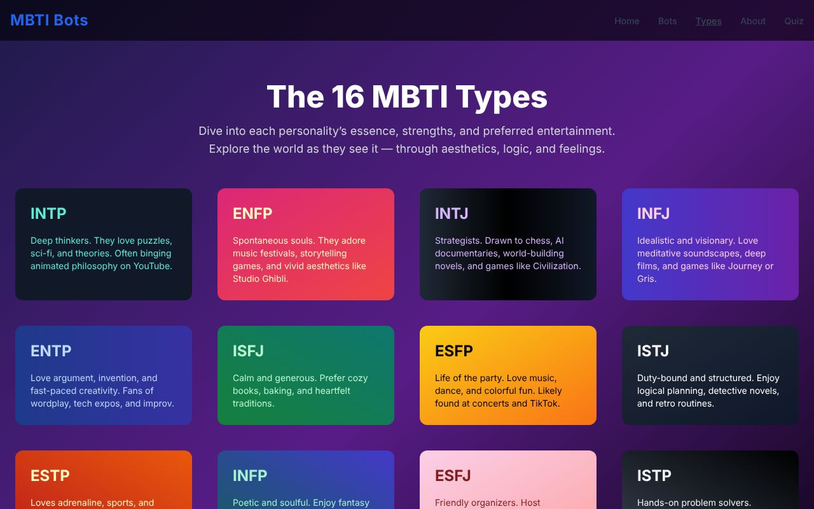
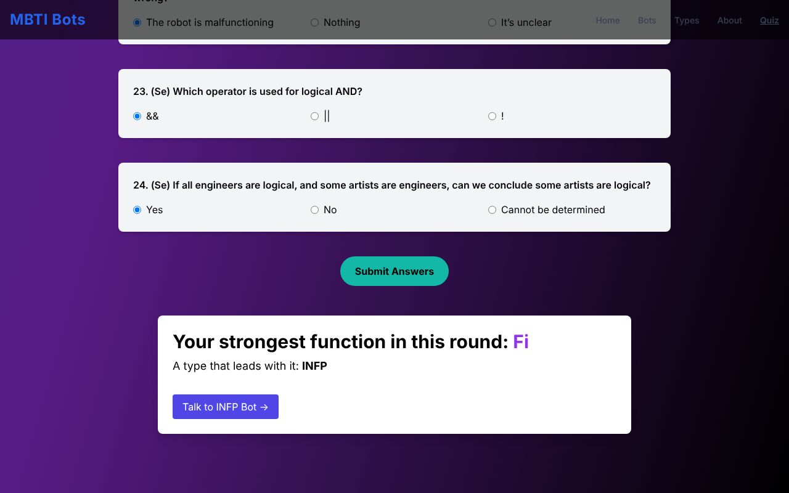
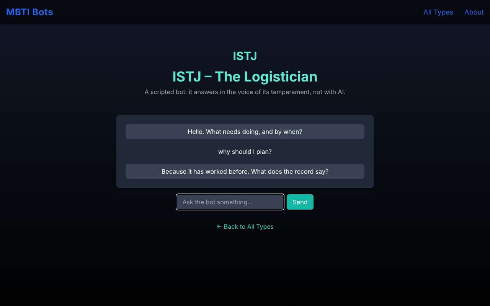

# MBTI Bot World

A static site with a page for each of the sixteen Myers-Briggs types, a scripted chat bot per type, and a short quiz built on the eight cognitive functions.



| Quiz | Bot |
| --- | --- |
|  |  |

## What is in it

- **Types** (`docs/types.html`): sixteen cards, each linking to its bot.
- **Bots** (`docs/bots/bot.html?type=intj`): one page serves all sixteen. Replies are scripted in `docs/js/chat.js`: each type speaks in the voice of its temperament (NT, NF, SJ, SP) and picks a line from keywords in what you typed. There is no AI and no network call.
- **Quiz** (`docs/quiz.html`): draws 3 questions per cognitive function from a bank of 96 (`docs/data/question_bank.json`), counts correct answers per function and points you at a type that leads with your strongest one.

The quiz is a toy. It measures how you did on 24 small puzzles, not your personality, and MBTI itself is not a validated psychological instrument.

## Run it

```bash
npx live-server docs        # or: python3 -m http.server -d docs
npm install && npm run build   # only if you change Tailwind classes
```

It is plain HTML, so GitHub Pages can serve it straight from `/docs`.

## Status

Revived in November 2026 from a half-finished state: the question bank was invalid JSON, the quiz asked frequency questions about right-or-wrong puzzles, twelve of the sixteen bot pages and the chat script did not exist, and links assumed the site lived at the domain root.

Still open:

- Seven types have no artwork (`istj, isfj, isfp, estj, esfp, entj, enfj`).
- Scroll animations load AOS from a CDN; the pages work without it.
- A 30 MB Node installer was committed by mistake. It is deleted, but it stays in the git history until the history is rewritten.
